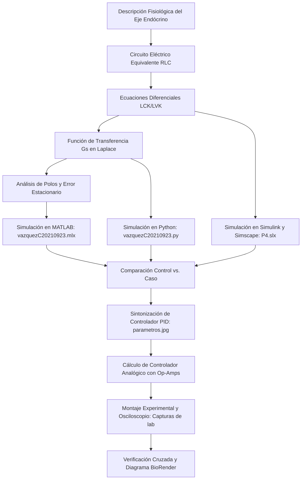

[](https://matlab.mathworks.com/open/github/v1?repo=nicole-vqz/MSFBP4)
# Práctica 4 — Modelado y control del sistema endócrino

Repositorio académico de la asignatura **Modelado de Sistemas Fisiológicos**, correspondiente al programa de **Ingeniería Biomédica** del Tecnológico Nacional de México / Instituto Tecnológico de Tijuana. Esta práctica integra modelado fenomenológico fisiológico, analogías eléctricas de segundo orden, derivaciones analíticas mediante leyes de Kirchhoff y transformada de Laplace, análisis de estabilidad y error en estado estacionario, sintonización de un controlador PID, diseño de controlador analógico mediante amplificadores operacionales, simulación computacional comparativa en MATLAB/Simulink, Simscape Electrical y Python, así como validación experimental en el Laboratorio de Electrónica.

El caso de estudio analiza un **modelo fenomenológico simplificado del sistema endócrino**. Se busca evaluar la respuesta dinámica del nivel hormonal efectivo $V_s(t)$ en un **individuo sano (Control)** contra una **condición fisiológica alterada (Caso)** caracterizada por la modificación simultánea en la capacidad de almacenamiento compartimental ($C$) y la oposición a la utilización o eliminación hormonal ($R_2$). Finalmente, se diseña un esquema de control en lazo cerrado para reducir la señal de error entre el paciente sintomático y la referencia del individuo sano.

**Docente:** Dr. Paul Antonio Valle Trujillo  
**Correo:** paul.valle@tectijuana.edu.mx  
**Departamento:** Departamento de Ingeniería Eléctrica y Electrónica  
**Institución:** Tecnológico Nacional de México / Instituto Tecnológico de Tijuana  
**Asignatura:** Modelado de Sistemas Fisiológicos  
**Programa:** Ingeniería Biomédica  
**Estudiante:** Nicole Vazquez Alvear · Número de control: C20210923 · lC20210923@tijuana.tecnm.mx  

**Repositorio de la asignatura:** https://github.com/nicole-vqz/MSFBP4 

**Sede:** Blvd. Alberto Limón Padilla s/n, Tijuana, C. P. 22454, B. C., México.

---

<a id="contenido"></a>
## Contenido

1. [Resumen](#resumen)
2. [Competencia y objetivos](#objetivos)
3. [Relación con el temario](#temario)
4. [Modelo fenomenológico y analogía eléctrica](#analogia)
5. [Formulación matemática y derivación analítica](#modelo)
6. [Parámetros del sistema: Control vs. Caso](#parametros)
7. [Análisis temporal, error estacionario y estabilidad](#analisis)
8. [Implementación en MATLAB, Simulink y Simscape](#matlab)
9. [Control en lazo cerrado, sintonización PID y diseño analógico](#pid)
10. [Reproducción en Python (VS Code)](#python)
11. [Diagrama biológico y correlación fisiológica](#biologico)
12. [Implementación experimental en laboratorio](#experimental)
13. [Resultados y verificación cruzada](#resultados)
14. [Flujo de trabajo](#flujo)
15. [Actividades del estudiante](#actividades)
16. [Estructura del repositorio](#estructura)
17. [Requisitos](#requisitos)
18. [Reproducibilidad y entregables](#reproducibilidad)
19. [Referencias](#referencias)

---

<a id="resumen"></a>
## Resumen

Esta práctica aborda la representación y análisis dinámico de un eje del **sistema endócrino** bajo condiciones fisiológicas normales y alteradas. Mediante un enfoque fenomenológico simplificado, se modelan los procesos de estímulo de secreción ($V_e(t)$), flujo de transporte hormonal ($F_e(t)$), pérdidas durante el transporte ($R_1$), acumulación temporal en compartimentos ($C$), inercia o retardo en la respuesta del tejido diana ($L$) y disipación o utilización hormonal ($R_2$).

A partir de la topología de un **circuito eléctrico equivalente RLC de segundo orden**, se formulan las ecuaciones integro-diferenciales en el dominio del tiempo y se obtiene la función de transferencia analítica exacta en el dominio de Laplace $G(s) = \frac{V_s(s)}{V_e(s)}$.

Se evalúa analítica y computacionalmente la posición de los polos, el error en estado estacionario y la respuesta al escalón unitario para la condición de **individuo sano (Control:** $C = 1\,\mu\mathrm{F}$, $R_2 = 100\,\mathrm{k}\Omega$**)** frente a la **condición alterada (Caso:** $C = 1000\,\mu\mathrm{F}$, $R_2 = 1\,\mathrm{k}\Omega$**)**. Para compensar la alteración dinámica, se implementa un sistema de control con retroalimentación negativa mediante un **controlador PID** sintonizado en Simulink, se calculan los componentes comerciales para su implementación física con amplificadores operacionales y se contrastan los resultados entre **MATLAB/Simulink**, **Simscape Electrical**, **Python** y el **montaje experimental en protoboard**.

> **Aviso académico:** El modelo y las correspondencias eléctricas presentadas constituyen una analogía fenomenológica con fines estrictamente académicos y didácticos; los valores de los componentes no representan magnitudes fisiológicas directas ni constituyen una directriz terapéutica clínica.

**Palabras clave:** sistema endócrino; analogía eléctrica; sistema de segundo orden; función de transferencia; ecuaciones de estado; controlador PID; amplificadores operacionales; Simscape Electrical; MATLAB; Python.

[Volver al contenido](#contenido)

---

<a id="objetivos"></a>
## Competencia y objetivos

### Competencia a desarrollar

Modelizar sistemas fisiológicos mediante analogías eléctricas, ecuaciones diferenciales y funciones de transferencia para analizar su comportamiento dinámico y diseñar estrategias de control mediante técnicas de control clásico. En particular, el estudiante interpretará una descripción simplificada de los procesos de secreción, transporte, almacenamiento y respuesta hormonal para proponer un circuito eléctrico equivalente de segundo orden, comparará una condición de referencia (control) con una condición alterada (caso), diseñará un controlador PID y contrastará los resultados obtenidos mediante modelado analítico, simulación computacional y experimentación en el Laboratorio de Electrónica.

### Objetivo general

Formular, simular, implementar experimentalmente y controlar el modelo dinámico de segundo orden del sistema endócrino mediante su circuito eléctrico equivalente, derivando analíticamente su función de transferencia, evaluando el impacto de las alteraciones en almacenamiento y disipación hormonal, y diseñando un controlador PID analógico y digital que reduzca el error respecto a la respuesta de referencia.

### Objetivos específicos

- Proponer la topología del circuito eléctrico RLC de segundo orden a partir de las hipótesis fisiológicas de secreción, transporte, almacenamiento y respuesta diana.
- Formular las ecuaciones integro-diferenciales y de estado del sistema mediante las leyes de Kirchhoff.
- Derivar analíticamente la función de transferencia $G(s) = \frac{V_s(s)}{V_e(s)}$ para las condiciones Control y Caso.
- Determinar la estabilidad del sistema en el plano complejo y el error en estado estacionario ante entrada escalón unitario.
- Implementar y validar el modelo en MATLAB (`vazquezC20210923.mlx`, `vazquezC20210923.pdf`), Simulink y Simscape Electrical (`P4.slx`).
- Sintonizar un controlador PID en lazo cerrado y diseñar su equivalente físico con amplificadores operacionales (`parametros.jpg`, `Scope.png`).
- Reproducir el modelado y el control en Python (`vazquezC20210923.py` y `Figure_phyton.png`) y contrastar las simulaciones con los resultados experimentales (`Capturas de lab 1.jpg` y `Capturas de lab 2.jpg`).
- Elaborar un diagrama biológico en BioRender (`Biorender sistema endocrino.jpg`) que correlacione el eje hormonal con el circuito eléctrico equivalente.

[Volver al contenido](#contenido)

---

<a id="temario"></a>
## Relación con el temario

La práctica integra contenidos pertenecientes a los tres ejes nodales del programa de **Modelado de Sistemas Fisiológicos (IBF-1020)**:

| Unidad | Área | Contenidos aplicados |
|---|---|---|
| I | Sistemas de control retroalimentados | Definición de señal de error $e(t) = V_{s,\text{control}}(t) - V_{s,\text{caso}}(t)$, retroalimentación negativa, análisis de polos y estabilidad |
| II | Modelado matemático | Analogías eléctricas en sistemas fisiológicos, leyes de Kirchhoff, ecuaciones diferenciales de segundo orden y funciones de transferencia |
| III | Controladores | Controlador PID, sintonización de ganancias ($k_P, k_I, k_D$) e implementación analógica mediante amplificadores operacionales |

[Volver al contenido](#contenido)

---

<a id="analogia"></a>
## Modelo fenomenológico y analogía eléctrica

El sistema endócrino regula procesos fisiológicos mediante la secreción de hormonas hacia la circulación para actuar sobre órganos diana. A partir de las hipótesis fenomenológicas del sistema, se construye el siguiente circuito eléctrico equivalente de segundo orden:

```
         Fe(t)                  Vs(t)
       -------->                  |
    +---[  R1  ]------------------+------------------+
    |                             |                  |
   (+)                          -----                |
  Ve(t)                         ----- C             [R2]
   (-)                            |                  |
    |                             |                  | Fs(t)
    |                             |                 ( ) L  (Inductor)
    |                             |                 ( )
    +-----------------------------+------------------+
                                 _|_  Referencia (GND)
```

### Correspondencia entre procesos fisiológicos y variables eléctricas

| Proceso o variable fisiológica | Representación eléctrica | Interpretación dentro del modelo |
|---|---|---|
| Estímulo para la secreción hormonal | $V_e(t)$ | Señal de entrada (voltaje) que activa la respuesta del sistema endócrino |
| Flujo de secreción y transporte hormonal | $F_e(t)$ | Corriente asociada con la transferencia de la señal hormonal hacia el compartimento |
| Pérdidas y oposición durante el transporte | $R_1$ | Resistencia que modela procesos que reducen o retardan la transmisión hormonal |
| Acumulación temporal de hormona | $C$ | Capacitancia que representa la capacidad del compartimento para almacenar señal hormonal |
| Retardo o inercia de respuesta del tejido diana | $L$ | Inductancia que representa la oposición dinámica a cambios rápidos en la respuesta |
| Utilización, disipación o eliminación hormonal | $R_2$ | Resistencia asociada con la desaparición o consumo de la señal en el órgano diana |
| Flujo asociado con la respuesta del tejido diana | $F_s(t)$ | Corriente en la rama inductivo-resistiva correspondiente a la respuesta biológica |
| Nivel hormonal efectivo | $V_s(t)$ | Voltaje de salida medido en el nodo central que representa el nivel hormonal disponible |

[Volver al contenido](#contenido)

---

<a id="modelo"></a>
## Formulación matemática y derivación analítica

### 1. Ecuaciones en el dominio del tiempo (Leyes de Kirchhoff)

Aplicando la Ley de Corrientes de Kirchhoff (LCK) en el nodo de salida $V_s(t)$:

$$
F_e(t) = i_C(t) + F_s(t)
$$

Donde las relaciones constitutivas de cada rama están dadas por:

$$
F_e(t) = \frac{V_e(t) - V_s(t)}{R_1}, \qquad i_C(t) = C \frac{dV_s(t)}{dt}, \qquad V_s(t) = L \frac{dF_s(t)}{dt} + R_2 F_s(t)
$$

Sustituyendo en la ecuación de nodo se obtiene el sistema de ecuaciones diferenciales de primer orden acopladas (variables de estado $V_s(t)$ y $F_s(t)$ asociadas a los dos elementos almacenadores de energía $C$ y $L$):

$$
\frac{dV_s(t)}{dt} = \frac{1}{R_1 C} V_e(t) - \frac{1}{R_1 C} V_s(t) - \frac{1}{C} F_s(t)
$$

$$
\frac{dF_s(t)}{dt} = \frac{1}{L} V_s(t) - \frac{R_2}{L} F_s(t)
$$

### 2. Obtención de la Función de Transferencia $G(s)$

Aplicando la Transformada de Laplace con condiciones iniciales nulas:

$$
\frac{V_e(s) - V_s(s)}{R_1} = C s V_s(s) + F_s(s)
$$

De la rama del tejido diana ($L$ y $R_2$ en serie):

$$
V_s(s) = (L s + R_2) F_s(s) \implies F_s(s) = \frac{V_s(s)}{L s + R_2}
$$

Sustituyendo $F_s(s)$ en la ecuación nodal y agrupando términos en $V_s(s)$:

$$
\frac{V_e(s)}{R_1} = \left( C s + \frac{1}{R_1} + \frac{1}{L s + R_2} \right) V_s(s)
$$

Desarrollando la suma de fracciones algebraicas:

$$
\frac{V_e(s)}{R_1} = \left[ \frac{R_1 C s (L s + R_2) + (L s + R_2) + R_1}{R_1 (L s + R_2)} \right] V_s(s)
$$

$$
V_e(s) = \left[ \frac{R_1 L C s^2 + (R_1 R_2 C + L) s + (R_1 + R_2)}{L s + R_2} \right] V_s(s)
$$

Despejando la relación salida-entrada se obtiene la **Función de Transferencia general de segundo orden**:

$$
\boxed{G(s) = \frac{V_s(s)}{V_e(s)} = \frac{L s + R_2}{R_1 L C s^2 + (R_1 R_2 C + L) s + (R_1 + R_2)}}
$$

[Volver al contenido](#contenido)

---

<a id="parametros"></a>
## Parámetros del sistema: Control vs. Caso

Para evaluar la alteración endócrina se utilizan valores comerciales de laboratorio, incrementando la capacitancia $C$ (mayor acumulación hormonal compartimental) y disminuyendo la resistencia $R_2$ (alteración en la disipación/respuesta del tejido diana):

| Componente | Símbolo | Individuo Sano (Control) | Condición Alterada (Caso) | Unidad eléctrica |
|---|---|---|---|---|
| Resistencia de transporte | $R_1$ | $1\,\mathrm{k}\Omega$ ($1000\,\Omega$) | $1\,\mathrm{k}\Omega$ ($1000\,\Omega$) | $\Omega$ |
| Inductancia de respuesta diana | $L$ | $100\,\mathrm{mH}$ ($0.1\,\mathrm{H}$) | $100\,\mathrm{mH}$ ($0.1\,\mathrm{H}$) | $\mathrm{H}$ |
| Capacitancia de almacenamiento | $C$ | **$1\,\mu\mathrm{F}$ ($1 \times 10^{-6}\,\mathrm{F}$)** | **$1000\,\mu\mathrm{F}$ ($1 \times 10^{-3}\,\mathrm{F}$)** | $\mathrm{F}$ |
| Resistencia de disipación | $R_2$ | **$100\,\mathrm{k}\Omega$ ($100\,000\,\Omega$)** | **$1\,\mathrm{k}\Omega$ ($1000\,\Omega$)** | $\Omega$ |

### Funciones de transferencia particulares

1. **Condición Control (Individuo Sano):**
   - Numerador: $0.1 s + 100\,000$
   - Coeficiente $s^2$: $R_1 L C = (1000)(0.1)(1 \times 10^{-6}) = 1 \times 10^{-4}$
   - Coeficiente $s^1$: $R_1 R_2 C + L = (1000)(100\,000)(1 \times 10^{-6}) + 0.1 = 100.1$
   - Coeficiente $s^0$: $R_1 + R_2 = 1000 + 100\,000 = 101\,000$

   $$
   \boxed{G_{\text{control}}(s) = \frac{0.1 s + 100\,000}{1 \times 10^{-4} s^2 + 100.1 s + 101\,000} = \frac{1000 s + 1 \times 10^9}{s^2 + 1\,001\,000 s + 1.01 \times 10^9}}
   $$

2. **Condición Caso (Paciente Alterado):**
   - Numerador: $0.1 s + 1000$
   - Coeficiente $s^2$: $R_1 L C = (1000)(0.1)(1 \times 10^{-3}) = 0.1$
   - Coeficiente $s^1$: $R_1 R_2 C + L = (1000)(1000)(1 \times 10^{-3}) + 0.1 = 1000.1$
   - Coeficiente $s^0$: $R_1 + R_2 = 1000 + 1000 = 2000$

   $$
   \boxed{G_{\text{caso}}(s) = \frac{0.1 s + 1000}{0.1 s^2 + 1000.1 s + 2000} = \frac{s + 10\,000}{s^2 + 10\,001 s + 20\,000}}
   $$

[Volver al contenido](#contenido)

---

<a id="analisis"></a>
## Análisis temporal, error estacionario y estabilidad

### 1. Localización de polos y estabilidad

Resolviendo la ecuación característica $s^2 + \frac{R_1 R_2 C + L}{R_1 L C} s + \frac{R_1 + R_2}{R_1 L C} = 0$:

- **Polos del Control (Sano):**
  $$
  s_{1} \approx -1010.02\,\mathrm{rad/s}, \qquad s_{2} \approx -999\,989.98\,\mathrm{rad/s}
  $$

- **Polos del Caso (Alterado):**
  $$
  s_{1} \approx -2.00\,\mathrm{rad/s}, \qquad s_{2} \approx -9999.00\,\mathrm{rad/s}
  $$

Todos los polos son reales, distintos y se ubican estrictamente en el **semiplano izquierdo ($\mathrm{Re}\{s\} < 0$)**, lo que demuestra que ambos sistemas son **BIBO estables** y sobreamortiguados. Sin embargo, en el **Caso**, el polo dominante se desplaza cerca del origen ($s_1 = -2\,\mathrm{rad/s}$), provocando una respuesta transitoria significativamente más lenta ($\tau \approx 0.5\,\mathrm{s}$).

### 2. Error en estado estacionario ante escalón unitario $V_e(s) = \frac{1}{s}$

Aplicando el Teorema del Valor Final $V_s(\infty) = \lim_{s \to 0} s \cdot G(s) \frac{1}{s} = \frac{R_2}{R_1 + R_2}$:

- **Control:**
  $$
  V_{s,\text{control}}(\infty) = \frac{100\,000}{1000 + 100\,000} = \frac{100}{101} \approx 0.9901\,\mathrm{V} \implies e_{ss,\text{control}} = 1 - 0.9901 = 0.0099\,(0.99\%)
  $$

- **Caso:**
  $$
  V_{s,\text{caso}}(\infty) = \frac{1000}{1000 + 1000} = 0.5000\,\mathrm{V} \implies e_{ss,\text{caso}} = 1 - 0.5000 = 0.5000\,(50.0\%)
  $$

La caída en $R_2$ provoca una pérdida del $50\%$ en el nivel hormonal efectivo estacionario del paciente respecto al estímulo aplicado.

[Volver al contenido](#contenido)

---

<a id="matlab"></a>
## Implementación en MATLAB, Simulink y Simscape

En el entorno MATLAB/Simulink (`vazquezC20210923.mlx`, `vazquezC20210923.pdf` y `P4.slx`) se desarrollan tres representaciones equivalentes para verificar la consistencia matemática y física del modelo:

1. **Modelo de ecuaciones integro-diferenciales:** Integradores continuos acoplados para $V_s(t)$ y $F_s(t)$.
2. **Modelo por función de transferencia:** Bloques `Transfer Fcn` con los polinomios de $G_{\text{control}}(s)$ y $G_{\text{caso}}(s)$ (`escalon_matlab.pdf`).
3. **Circuito físico en Simscape Electrical:** Topología RLC armada con componentes eléctricos reales y sensores de voltaje (`Scope.png`).

### Fragmento de código en MATLAB (`vazquezC20210923.mlx`)

```matlab
% Parámetros Control (Individuo Sano)
R1_ctrl = 1e3; L_ctrl = 0.1; C_ctrl = 1e-6; R2_ctrl = 100e3;
num_ctrl = [L_ctrl, R2_ctrl];
den_ctrl = [R1_ctrl*L_ctrl*C_ctrl, R1_ctrl*R2_ctrl*C_ctrl + L_ctrl, R1_ctrl + R2_ctrl];
G_ctrl = tf(num_ctrl, den_ctrl);

% Parámetros Caso (Condición Alterada)
R1_caso = 1e3; L_caso = 0.1; C_caso = 1e-3; R2_caso = 1e3;
num_caso = [L_caso, R2_caso];
den_caso = [R1_caso*L_caso*C_caso, R1_caso*R2_caso*C_caso + L_caso, R1_caso + R2_caso];
G_caso = tf(num_caso, den_caso);
```

[Volver al contenido](#contenido)

---

<a id="pid"></a>
## Control en lazo cerrado, sintonización PID y diseño analógico

### 1. Esquema de control en lazo cerrado

Para que la respuesta hormonal del Caso siga la trayectoria dinámica del Control sano, se implementa un lazo de retroalimentación negativa en `P4.slx`:

```
             +---------+   e(t)   +---------+  u(t)  +----------+  Vs,PID(t)
Ve(t) = u(t) | Control |--(+)---->|   PID   |------->| Paciente |----+----> [Scope]
      +----->+---------+   | -    +---------+        |  (Caso)  |    |
      |       (Sano)       +-------------------------+----------+    |
      |                    |                                         |
      |                    +-----------------------------------------+
      |      +----------+  Vs,caso(t)
      +----->| Paciente |-------------------------------------------------> [Scope]
             |  (Caso)  |
             +----------+
```

La señal de error se define como:

$$
e(t) = V_{s,\text{control}}(t) - V_{s,\text{caso}}(t)
$$

### 2. Sintonización PID e implementación analógica

A partir de las ganancias $k_P$, $k_I$ y $k_D$ obtenidas mediante la herramienta `Tune` de Simulink ([`parametros.jpg`](parametros.jpg)), se calculan los valores comerciales de resistencias y capacitores para construir el controlador PID analógico con amplificadores operacionales (etapas proporcional, integradora, derivativa y sumador inversor) con alimentación simétrica.

[Volver al contenido](#contenido)

---

<a id="python"></a>
## Reproducción en Python (VS Code)

El archivo `vazquezC20210923.py` implementa las funciones de transferencia en tiempo continuo y la simulación en lazo abierto y cerrado en el intervalo $t \in [0, 10]\,\mathrm{s}$ utilizando `scipy.signal` y `matplotlib`, exportando la gráfica comparativa como [`Figure_phyton.png`](Figure_phyton.png).

```python
import numpy as np
import scipy.signal as signal
import matplotlib.pyplot as plt

# Función de transferencia Control (Individuo sano)
num_ctrl = [0.1, 100000]
den_ctrl = [1e-4, 100.1, 101000]
sys_ctrl = signal.TransferFcn(num_ctrl, den_ctrl)

# Función de transferencia Caso (Paciente)
num_caso = [0.1, 1000]
den_caso = [0.1, 1000.1, 2000]
sys_caso = signal.TransferFcn(num_caso, den_caso)

# Simulación ante escalón unitario t in [0, 10] s
t = np.linspace(0, 10, 2000)
t_ctrl, y_ctrl = signal.step(sys_ctrl, T=t)
t_caso, y_caso = signal.step(sys_caso, T=t)

plt.figure(figsize=(8, 5))
plt.plot(t_ctrl, y_ctrl, 'b-', linewidth=2, label='Control (Individuo sano)')
plt.plot(t_caso, y_caso, 'r--', linewidth=2, label='Caso (Condición alterada)')
plt.title('Respuesta al Escalón del Sistema Endócrino')
plt.xlabel('Tiempo [s]')
plt.ylabel('Nivel hormonal efectivo Vs(t) [V]')
plt.grid(True)
plt.legend()
plt.savefig('Figure_phyton.png')
plt.show()
```

[Volver al contenido](#contenido)

---

<a id="biologico"></a>
## Diagrama biológico y correlación fisiológica

Mediante ilustración científica desarrollada en **BioRender** ([`Biorender sistema endocrino.jpg`](Biorender%20sistema%20endocrino.jpg)), se vinculan los órganos y mecanismos del eje endócrino (glándula secretora, torrente sanguíneo, compartimento extracelular de almacenamiento y receptores en el tejido diana) con cada componente pasivo del circuito equivalente RLC.

[Volver al contenido](#contenido)

---

<a id="experimental"></a>
## Implementación experimental en laboratorio

Los circuitos correspondientes al **Control**, al **Caso** y al **controlador PID analógico** fueron ensamblados físicamente en protoboard utilizando componentes comerciales y amplificadores operacionales con fuente simétrica. Se aplicó una señal cuadrada de baja frecuencia mediante el generador de funciones para aproximar un escalón unitario $V_e(t) = u(t)$ y se registraron las formas de onda mediante el osciloscopio digital:

- **Montaje y captura experimental 1:** [`Capturas de lab 1.jpg`](Capturas%20de%20lab%201.jpg)
- **Montaje y captura experimental 2:** [`Capturas de lab 2.jpg`](Capturas%20de%20lab%202.jpg)

[Volver al contenido](#contenido)

---

<a id="resultados"></a>
## Resultados y verificación cruzada

Se comprueba la equivalencia dinámica entre los distintos entornos de simulación y los resultados medidos en laboratorio:

| Etapa / Herramienta | Archivo de evidencia | Descripción |
|---|---|---|
| Reporte integral de la práctica | [`Modelo y Control Del Sistema Endócrino....pdf`](Modelo%20y%20Control%20Del%20Sistema%20Endócrino....pdf) | Documento general del desarrollo analítico y experimental |
| Live Script y resultados MATLAB | [`vazquezC20210923.mlx`](vazquezC20210923.mlx), [`vazquezC20210923.pdf`](vazquezC20210923.pdf) | Código y exportación completa de resultados computacionales en MATLAB |
| Respuesta al escalón en MATLAB | [`escalon_matlab.pdf`](escalon_matlab.pdf) | Comparativa de la respuesta temporal de Control y Caso en MATLAB |
| Simulación en Simulink / Simscape | [`P4.slx`](P4.slx), [`Scope.png`](Scope.png), [`parametros.jpg`](parametros.jpg) | Modelo de bloques, parámetros de sintonización PID y salida del osciloscopio virtual |
| Simulación numérica en Python | [`vazquezC20210923.py`](vazquezC20210923.py), [`Figure_phyton.png`](Figure_phyton.png) | Código fuente y gráfica generada en Python para verificación cruzada |
| Implementación física en laboratorio | [`Capturas de lab 1.jpg`](Capturas%20de%20lab%201.jpg), [`Capturas de lab 2.jpg`](Capturas%20de%20lab%202.jpg) | Fotografías del montaje en protoboard y capturas del osciloscopio real |

### Factores de discrepancia entre simulación y experimentación

- Tolerancias comerciales de resistores ($\pm 5\%$), capacitores electrolíticos/cerámicos ($\pm 10\% - 20\%$) e inductores.
- Resistencia serie interna del inductor ($R_L$) y resistencia serie equivalente (ESR) del capacitor de $1000\,\mu\mathrm{F}$.
- Saturación de voltaje de salida y corrientes de polarización de los amplificadores operacionales reales.

[Volver al contenido](#contenido)

---

<a id="flujo"></a>
## Flujo de trabajo



[Volver al contenido](#contenido)

---

<a id="actividades"></a>
## Actividades del estudiante

- [x] **1. Circuito equivalente:** Proponer el circuito RLC de segundo orden identificando $V_e(t)$, $V_s(t)$, $R_1$, $C$, $L$, $R_2$, $F_e(t)$ y $F_s(t)$.
- [x] **2. Modelo matemático:** Obtener las ecuaciones de estado y derivar $G_{\text{control}}(s)$ y $G_{\text{caso}}(s)$.
- [x] **3. Análisis dinámico:** Calcular polos, estabilidad y error en estado estacionario ante entrada escalón unitario.
- [x] **4. Simulación MATLAB/Simulink:** Implementar ecuaciones diferenciales, funciones de transferencia y Simscape Electrical (`vazquezC20210923.mlx` y `P4.slx`).
- [x] **5. Control PID:** Construir el lazo cerrado con $e(t) = V_{s,\text{control}}(t) - V_{s,\text{caso}}(t)$ y sintonizar $k_P, k_I, k_D$ (`parametros.jpg`).
- [x] **6. Reproducción en Python:** Programar y graficar las respuestas en `vazquezC20210923.py` generando `Figure_phyton.png`.
- [x] **7. Experimentación en laboratorio:** Armar los circuitos y el PID analógico en protoboard y capturar resultados (`Capturas de lab 1.jpg`, `Capturas de lab 2.jpg`).
- [x] **8. Documentación:** Integrar diagramas de BioRender (`Biorender sistema endocrino.jpg`), licencia y reporte final en GitHub (`README.md`).

[Volver al contenido](#contenido)

---

<a id="estructura"></a>
## Estructura del repositorio

```text
.
├── README.md                                       # Reporte principal y documentación de la práctica
├── LICENSE                                         # Licencia de uso académico y distribución
├── Biorender sistema endocrino.jpg                 # Diagrama de correlación fisiológica (BioRender)
├── Modelo y Control Del Sistema Endócrino....pdf   # Documento general de la práctica
├── parametros.jpg                                  # Parámetros y ganancias del controlador PID
├── Capturas de lab 1.jpg                           # Evidencia experimental en laboratorio (lazo abierto)
├── Capturas de lab 2.jpg                           # Evidencia experimental en laboratorio (lazo cerrado)
├── vazquezC20210923.pdf                            # Exportación en PDF del Live Script de MATLAB
├── vazquezC20210923.mlx                            # Cuaderno computacional principal en MATLAB
├── escalon_matlab.pdf                              # Gráfica de respuesta al escalón en MATLAB
├── Figure_phyton.png                               # Gráfica de simulación generada en Python
├── vazquezC20210923.py                             # Código fuente de simulación en Python
├── P4.slx                                          # Modelo en Simulink y Simscape Electrical
└── Scope.png                                       # Captura de resultados del Scope en Simulink
```

[Volver al contenido](#contenido)

---

<a id="requisitos"></a>
## Requisitos

### Software

- **MATLAB** (R2021a o superior) con **Simulink**, **Control System Toolbox** y **Simscape Electrical**.
- **Python 3.8+** con las librerías `numpy`, `scipy` y `matplotlib`.
- **Visual Studio Code** para la ejecución del script en Python.

### Hardware y equipo de laboratorio

- Protoboard, fuente de alimentación simétrica DC, generador de funciones y osciloscopio digital.
- Resistores ($1\,\mathrm{k}\Omega$, $100\,\mathrm{k}\Omega$ y valores calculados para PID), capacitores ($1\,\mu\mathrm{F}$, $1000\,\mu\mathrm{F}$), inductor ($100\,\mathrm{mH}$) y amplificadores operacionales.

[Volver al contenido](#contenido)

---

<a id="reproducibilidad"></a>
## Reproducibilidad y entregables

1. Clonar el repositorio localmente mediante `git clone`.
2. Abrir MATLAB y ejecutar el Live Script `vazquezC20210923.mlx` para inicializar parámetros y generar `escalon_matlab.pdf` y `vazquezC20210923.pdf`.
3. Abrir y simular `P4.slx` en Simulink para validar las tres implementaciones y el controlador PID (`parametros.jpg` y `Scope.png`).
4. Ejecutar `vazquezC20210923.py` desde Visual Studio Code para generar `Figure_phyton.png` y contrastar los resultados computacionales.
5. Revisar las evidencias experimentales `Capturas de lab 1.jpg` y `Capturas de lab 2.jpg` correspondientes a las pruebas físicas en protoboard.

[Volver al contenido](#contenido)

---

<a id="referencias"></a>
## Referencias

[1] M. C. Khoo, *Physiological Control Systems: Analysis, Simulation, and Estimation*, 2nd ed., IEEE Press, 2018.

[2] F. C. Hoppensteadt y C. S. Peskin, *Modeling and Simulation in Medicine and the Life Sciences*, Springer.

[3] J. E. Hall, *Guyton and Hall Textbook of Medical Physiology*, 14th ed., Elsevier, 2021.

[4] K. Ogata, *Ingeniería de Control Moderna*, 5.ª ed., Pearson Educación, 2010.

[5] N. S. Nise, *Control Systems Engineering*, 8th ed., John Wiley & Sons, 2020.

[6] P. A. Valle, *Syllabus para Modelado de Sistemas Fisiológicos*, Tecnológico Nacional de México / Instituto Tecnológico de Tijuana, Tijuana, B. C., México, 2026.

[7] Tecnológico Nacional de México, *Programa de estudio de la asignatura Modelado de Sistemas Fisiológicos, IBF-1020*.

---

## Uso académico

Este repositorio constituye la evidencia documental, computacional y experimental de la práctica **5.6 Modelado y control del sistema endócrino**, desarrollado por **Nicole Vazquez Alvear (C20210923)** bajo los términos especificados en el archivo `LICENSE`.
